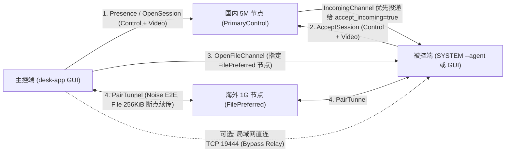

# FlashDesk 架构设计、开发约束与踩坑交接文档

> 本文档面向后续接手维护、排错与扩展开发 **FlashDesk** 的 AI Agent 及人类开发者，完整记录已定稿的系统架构、模块职责、工具链与打包规范，以及开发和真机联调过程中实际踩过并已解决的全部核心问题（Pitfalls #1–#19）。

---

## 一、项目定位与已确认设计方案

**FlashDesk** 是一套自建不限速、60fps 的 Windows 全栈 Rust 远程桌面软件，目标是在无第三方限速和账号体系的前提下替代向日葵，适合自用及多台常用电脑之间长期互连。

### 核心设计决策（已通过 `/grill-me` 对齐并落地）
1. **技术栈**：Rust 工作区（`protocol` + `relay-server` + `desk-app`）+ 原生 GPU GUI（`eframe` 0.31 / `egui`，使用 **`glow` OpenGL 后端**）+ Windows SDK（`windows` 0.58：`DXGI` / `D3D11` / `GDI` / `Media Foundation` / Win32 Services & SetupAPI）。
2. **All-in-One 单文件便携客户端（双形态合一）**：
   - 默认双击即为无黑框便携绿色 GUI 客户端（配置与根私钥固定存放在 `%USERPROFILE%\.flashdesk\config.json` 与 `root.key`，避免切换 exe 路径丢失身份；系统服务严禁写入空配置）。
   - 支持一键提权（UAC）注册为 Windows `SYSTEM` 后台服务 `FlashDeskService`（Session 0 常驻守护 `--service` + 自动拉起 Session 1 交互桌面代理 `--agent`），支持锁屏（`Winlogon`）、UAC 管理员弹窗穿透及通过 `sas.dll` 发送真实 `Ctrl+Alt+Del`。
   - **服务与桌面 GUI 共存**：若本机系统服务已运行，桌面 GUI 仍可启动作为「主控发起端」，并通过 `PresenceClientMsg::UpdateInfo { accept_incoming: false }` 让中转服优先将入站控屏请求路由给 `accept_incoming: true` 的 SYSTEM 服务实例。
3. **网络拓扑（多节点纯自建中转 + 局域网直连）**：
   - 不做 P2P 打洞、不依赖额外组网软件。支持同时挂载多台自建中转节点（典型场景：**国内 5M 低延迟节点**作 `PrimaryControl` 主控屏与输入，**海外 1G 大带宽节点**作 `FilePreferred` 大文件分流）。
   - 中转端通过 `ConnectionPurpose::PairTunnel` 支持**跨节点无 Presence 临时对接**：控屏仍走国内 5M 低延迟通道，文件传输由主控通过 `ControlMsg::OpenFileChannel` 通知被控端共同直连海外 1G 节点建立独立的端到端加密文件通道，互不抢占带宽。
   - 同步开放局域网 / IP 直连（默认 TCP `19444`，绕过中转服，保留同等端到端加密与文件分流能力）。
4. **安全模型（个人 Ed25519 Root CA + Noise 端到端加密）**：
   - 由个人主设备（或 `flashdesk-relay init-root`）生成 **Ed25519 个人根密钥**；每台设备持有一份由根私钥签发的 `DeviceCert`（打包为 `.fdesk` JSON 或 Base64 Token），并支持 `revoked_device_ids` 设备吊销名单。
   - **Zero-Trust 中转服务器**：中转端仅配置 `root_pubkey_b64` 与吊销列表用于 `RelayAuthRequest` 质询签名验真，无法解密客户端之间的控制、画面与文件数据。
   - **端到端加密**：客户端之间所有直连与中转隧道均执行 `Noise_XX_25519_ChaChaPoly_BLAKE2s` 握手，并将 `DeviceCert` 与握手哈希以跨域签名（`FLASHDESK-NOISE-BIND-V1`）密码学绑定。

---

## 二、工作区结构与核心数据流

### 1. 文件树与职责划分

```text
e:\Antigravity项目\自用远程软件\
├── AGENTS.md                           # AI 接手速查红线（工具链、禁区、验证命令）
├── Cargo.toml                          # Workspace 根配置（release: opt-level=3, thin LTO, strip="symbols"）
├── .cargo\config.toml                  # target-dir 映射至 D:\Rust\target-flashdesk、GNU 链接及 Linux musl 交叉配置
├── docs\ARCHITECTURE_AND_PITFALLS.md   # 本文档
├── deploy\
│   ├── deploy-relay.sh                 # Ubuntu 一键部署脚本（LF 换行、BBR、32MB TCP 缓冲、CAP_NET_BIND_SERVICE、systemd）
│   ├── flashdesk-relay-linux-x86_64    # Windows 交叉编译出的静态 Linux x86_64 中转端二进制
│   └── README.md                       # Ubuntu 部署与运维命令说明
├── target\release\                     # 发布二进制落盘目录（不放临时文件）
│   ├── flashdesk.exe                   # Windows 全功能单文件 GUI/服务一体化客户端
│   ├── flashdesk-relay.exe             # Windows 中转端 / 密钥签发 CLI
│   └── flashdesk-relay-linux-x86_64    # deploy\ 下静态 Linux 中转端同步副本
└── crates\
    ├── protocol\                       # 共享线协议、身份密码学与加密流传输
    │   └── src\
    │       ├── lib.rs                  # 公共导出与 ProtocolError
    │       ├── auth.rs                 # Ed25519 RootKeypair、DeviceCert、DeviceBundle (fdesk://v2/ / .fdesk)、RevocationCommand
    │       ├── framing.rs              # 4 字节大端长度前缀帧读写（MAX_FRAME_LEN）
    │       ├── noise.rs                # Noise_XX_25519_ChaChaPoly_BLAKE2s + Split Reader/Writer 分片大帧传输
    │       ├── relay.rs                # RelayHello / RelayAuthRequest / ConnectionPurpose / Presence*（含 SyncRevocations / SetDisplayName）
    │       ├── session.rs              # VideoCodec / MonitorInfo / InputEvent / ClipboardData / Vdd* / ControlMsg
    │       └── transfer.rs             # FileEntry / FileMsg（目录浏览、Chunked 断点续传与 SHA-256 校验协议）
    ├── relay-server\                   # 自建无状态感知纯 TCP 中转服务器（flashdesk-relay）
    │   ├── src\
    │   │   ├── main.rs                 # CLI: serve (--state-dir) / init-root / issue-bundle
    │   │   ├── config.rs               # RelayConfig (relay.toml 解析)
    │   │   ├── state.rs                # PeerEntry 路由表、PendingTunnel 配对、远程吊销验签踢人与持久化
    │   │   └── server.rs               # 认证握手、Presence 心跳（25s 超时）、实时吊销同步、交互/文件分缓冲转发
    │   └── tests\relay_e2e.rs          # 中转端 6 项端到端集成测试
    └── desk-app\                       # Windows 桌面端 + 被控系统服务（flashdesk.exe）
        ├── build.rs                    # Windows GNU 下静态链接 libstdc++.a / libwinpthread.a / libgcc*.a 组参数
        └── src\
            ├── main.rs                 # CLI 路由、GUI 单例互斥、attach_parent_console、panic 弹窗/日志、--self-test
            ├── config.rs               # AppConfig（固定 %USERPROFILE%\.flashdesk\config.json 与分离 root.key、已签发台账）
            ├── capture\                # 抓屏模块
            │   ├── monitors.rs         # DXGI 适配器与输出枚举 + GetDpiForMonitor (Per-Monitor DPI v2)
            │   └── dxgi.rs             # 三层单屏抓取（DuplicateOutput1 → DuplicateOutput → GdiSingleCapturer）与全景合成
            ├── codec\                  # 硬件与软件编解码管道
            │   ├── mod.rs              # probe_capabilities（独立线程防 COM 冲突 + 640x360 出帧探活）、BT.709 NV12/RGBA 转换
            │   ├── mf_common.rs        # MFStartup、ensure_com_mta、poll_event_until 超时轮询、Annex-B 参数集提取
            │   ├── mf_encoder.rs       # Media Foundation 硬件 HEVC / H.264 低延迟 CBR 编码器
            │   ├── mf_decoder.rs       # Media Foundation HEVC / H.264 解码器
            │   └── openh264_codec.rs   # 内嵌源码静态编译 OpenH264 软编解码回退
            ├── input\win_input.rs      # 虚拟桌面归一化坐标映射 + SendInput + agent_mode 下桌面同步 + SendSAS
            ├── clipboard\mod.rs        # arboard + png + sha2 + GetClipboardSequenceNumber 防回环双向剪贴板（图 ≤ 8 MiB）
            ├── transfer\               # 文件传输引擎（256 KiB 分块、.fdesk.part/.fdesk.meta 断点续传、SHA-256）
            │   ├── mod.rs
            │   ├── host_handler.rs     # 被控端文件请求处理
            │   └── client_manager.rs   # 主控端队列、海外节点 PairTunnel 分流与重连生命周期管理
            ├── service\                # Windows SYSTEM 服务体系
            │   ├── desktop.rs          # OpenInputDesktop + SetThreadDesktop 切换至 Winlogon/UAC + sas.dll SendSAS
            │   ├── health.rs           # agent.status.json 心跳（pid/session/elevated/12s 新鲜度）+ GUI 接管判定唯一依据
            │   ├── install.rs          # SCM 安装/查询/重启/卸载、SoftwareSASGeneration 注册表授权、C:\ProgramData\FlashDesk\config.json 同步
            │   └── win_service.rs      # Session 0 SCM 控制循环 + 启用 SeTcbPrivilege 后 WTSGetActiveConsoleSessionId 启动 Session 1 --agent
            ├── vdd\mod.rs              # Parsec VDD SetupAPI/IOCTL 增删与 100ms 心跳、Virtual-Display-Driver/OrayIddDriver 检测、ChangeDisplaySettingsExW
            ├── net\                    # 会话网络层
            │   ├── mod.rs              # connect_and_auth_relay 握手
            │   ├── relay_client.rs     # Presence 保活与 IncomingChannel 分派（10s Noise 握手超时）
            │   ├── host_session.rs     # 被控端推流：编码前背压、关键帧限频、尾帧冲刷、分辨率上限、HostStats；H.264 异常切 OpenH264
            │   ├── flow.rs             # 帧确认驱动的延迟闸门（AIMD 在途窗口 + ProbeRTT）与自适应码率（ABR），含 5M 链路仿真单测
            │   ├── viewer_session.rs   # 主控端：解码队列不丢帧、批量解码只转最新帧、FrameAck（视频通道反向）、关键帧请求限频
            │   ├── bench.rs            # --link-bench：合成桌面 + 限速中转代理的端到端基准（标记块测“抓屏→解码”延迟）
            │   └── direct.rs           # TCP 19444 局域网直连监听与通道分流（serve_direct_connection 供基准复用）
            └── ui\                     # egui 界面层
                ├── theme.rs            # 强制暗色主题（不跟随系统浅色）、msyh/msyhbd 字体、色板与卡片/按钮/分段/开关/Toast 组件
                ├── sysinfo.rs          # 服务/agent/虚拟屏/局域网 IP 状态后台轮询（2 s），UI 线程只读快照
                ├── screen.rs           # 小屏适配：启动后按显示器工作区（扣除任务栏）缩小/居中窗口，最小尺寸随屏幕下调
                ├── tray.rs             # Windows 系统托盘与 GUI 单例防多开：点 X 隐入托盘、重开或点击恢复窗口、托盘右键退出
                ├── app.rs              # 顶部导航、.fdesk 拖拽导入、配置保存自动同步服务、热切中转节点
                ├── home.rs             # 首次引导（填地址一键建根）、本机身份与服务同步提示、在线设备 + IP 直连
                ├── settings.rs         # root.key 管理、二维码 & fdesk://v2/ 签发、已签发台账与一键远程吊销、节点/VDD/画质设置
                └── remote_view.rs      # 远控画面、悬浮工具栏（画质/工具/默认收起的「详情」HUD）、热切控屏中转节点、双栏文件管理+拖拽上传、虚拟屏浮窗、断开对话框
```

### 2. 核心会话与分流拓扑



---

## 三、工具链、编译打包与验证清单（硬约束）

### 1. 工具链存放红线
- **严禁把 Rust 工具链或缓存写入系统盘用户目录（`~/.rustup` 或 `~/.cargo`）**。
- 所有 Rust 工具链严格固定在 `D:\Rust`：
  - Rust `1.100.0`（`stable-x86_64-pc-windows-gnu`）+ `x86_64-unknown-linux-musl` 目标
  - `RUSTUP_HOME = D:\Rust\rustup`
  - `CARGO_HOME = D:\Rust\cargo`
  - WinLibs Portable MinGW-w64 `16.2.0`：`D:\Rust\mingw64\bin`
  - 构建产物目录（见 [.cargo/config.toml](../.cargo/config.toml)）：`target-dir = "D:\\Rust\\target-flashdesk"`

每次在 PowerShell 中调用 `cargo` / `rustup` 前**必须**显式注入环境变量：
```powershell
$env:RUSTUP_HOME = "D:\Rust\rustup"
$env:CARGO_HOME = "D:\Rust\cargo"
$env:PATH = "D:\Rust\cargo\bin;D:\Rust\mingw64\bin;$env:PATH"
```

**没有 `D:` 数据盘的机器**（例如 `D:` 是光驱的虚拟机）：把同一套工具链（Rust 1.100.0 GNU + musl 目标、WinLibs GCC 16.2.0 **MSVCRT** 版）装到任意纯 ASCII 非用户目录（如 `C:\Rust`），**不要改 `.cargo/config.toml`**，用环境变量覆盖即可（环境变量优先级高于配置文件）：
```powershell
$env:RUSTUP_HOME = "C:\Rust\rustup"; $env:CARGO_HOME = "C:\Rust\cargo"
$env:PATH = "C:\Rust\cargo\bin;C:\Rust\mingw64\bin;$env:PATH"
$env:CARGO_TARGET_DIR = "C:\Rust\target-flashdesk"
$env:CARGO_TARGET_X86_64_PC_WINDOWS_GNU_LINKER = "C:\Rust\mingw64\bin\x86_64-w64-mingw32-g++.exe"
$env:CARGO_TARGET_X86_64_UNKNOWN_LINUX_MUSL_LINKER = "C:\Rust\rustup\toolchains\stable-x86_64-pc-windows-gnu\lib\rustlib\x86_64-pc-windows-gnu\bin\rust-lld.exe"
$env:FLASHDESK_MINGW_DIR = "C:\Rust\mingw64"   # build.rs 的静态库搜索路径（默认 D:\Rust\mingw64）
```

### 2. 全量测试与双平台 Release 编译命令
```powershell
# 1) 运行全部单元与集成测试（desk-app 25 + protocol 6 + relay_e2e 5 = 36 项，含 flow.rs 的 5M 链路仿真）
cargo test --workspace

# 2) 编译 Windows Release（flashdesk.exe 与 flashdesk-relay.exe）
cargo build --release --workspace

# 3) 交叉编译静态 Ubuntu Linux x86_64 中转端二进制（使用 rust-lld.exe + crt-static）
cargo build --release -p relay-server --target x86_64-unknown-linux-musl

# 4) 同步发布产物到 target\release 与 deploy\（注意先关闭正在运行的旧 flashdesk.exe）
Copy-Item "D:\Rust\target-flashdesk\release\flashdesk.exe" "target\release\flashdesk.exe" -Force
Copy-Item "D:\Rust\target-flashdesk\release\flashdesk-relay.exe" "target\release\flashdesk-relay.exe" -Force
Copy-Item "D:\Rust\target-flashdesk\x86_64-unknown-linux-musl\release\flashdesk-relay" "deploy\flashdesk-relay-linux-x86_64" -Force
Copy-Item "D:\Rust\target-flashdesk\x86_64-unknown-linux-musl\release\flashdesk-relay" "target\release\flashdesk-relay-linux-x86_64" -Force
```

### 3. 每次发版前的必跑验收审计
1. **PE 子系统与零 MinGW DLL 审计**（注意 `objdump` 需 `Push-Location` 后传相对路径）：
   ```powershell
   Push-Location target\release
   D:\Rust\mingw64\bin\objdump.exe -p .\flashdesk.exe | Select-String "Subsystem"    # 必须为 00000002 (Windows GUI)
   D:\Rust\mingw64\bin\objdump.exe -p .\flashdesk.exe | Select-String "DLL Name"     # 严禁出现 libstdc++-6.dll / libwinpthread-1.dll / libgcc_s_seh-1.dll
   D:\Rust\mingw64\bin\objdump.exe -p .\flashdesk-relay.exe | Select-String "DLL Name"
   Pop-Location
   ```
2. **Linux ELF64 静态链接与部署脚本检查**：
   - 验证 `deploy\flashdesk-relay-linux-x86_64` 前 24 字节符合 ELF64 little-endian `x86_64`（`7F 45 4C 46 02 01 ... 03 00 3E 00`），且不含 `ld-linux-x86-64.so` / `ld-musl-x86_64.so`。
   - 验证 `deploy\deploy-relay.sh` 为纯 LF 换行（`0x0D` 计数为 `0`），并用 `D:\Git\bin\bash.exe -n deploy\deploy-relay.sh` 校验语法。
3. **剔除 MinGW `PATH` 的洁净环境真机运行测试**：
   ```powershell
   $cleanPath = ($env:PATH -split ';' | Where-Object { $_ -and ($_ -notmatch 'mingw') -and ($_ -notmatch 'Rust\\cargo') }) -join ';'
   $env:PATH = $cleanPath
   # 测试 GUI 无参启动持续存活且无错误日志；测试 --self-test 返回 0：
   Start-Process -FilePath .\target\release\flashdesk.exe -ArgumentList "--self-test" -Wait -PassThru
   ```
4. **5M 中转端到端基准（改动抓屏/编解码/传输/流控后必跑）**：真实编码器 + Noise + 流控/ABR + 解码器，只把屏幕换成 60Hz 合成桌面（滚动文档 + 打字），经过一个模拟国内 5M 小水管中转的限速代理（共享瓶颈、单向 15ms、1s 深缓冲）。退出码 0 = PASS（滚动 ≥ 0.9×目标帧率，且两个阶段“抓屏→解码”p95 ≤ 2×单向延迟 + 120ms）：
   ```powershell
   .\target\release\flashdesk.exe --link-bench | Out-String                                   # 默认 5Mbps / 1080p60 / 上限 4000kbps
   .\target\release\flashdesk.exe --link-bench --bench-res 2560x1440 --bench-cap 1080 | Out-String  # 2K 屏 + 1080p 上限
   .\target\release\flashdesk.exe --link-bench --bench-no-ack | Out-String                    # 对照：关闭帧确认（旧传输行为）
   ```

---

## 四、完整踩坑记录与避坑红线（Pitfalls #1–#19）

### A. 工具链、编译与打包类

#### 坑 #1：无管理员提权环境安装 VS Build Tools 必定失败
- **现象**：尝试安装 `vs_BuildTools.exe` 获取 MSVC 链接器时在沙箱 UAC 下连续两次直接退出并返回 `1602` (`0x80070642`)。
- **根因**：AI 执行沙箱运行在非提权环境，任何需要 UAC 提权的安装包均会被拒绝。
- **方案**：全量切换至纯用户态的 `stable-x86_64-pc-windows-gnu` + 绿色便携版 WinLibs MinGW-w64（置于 `D:\Rust\mingw64`），并在 [.cargo/config.toml](../.cargo/config.toml) 配置 `x86_64-w64-mingw32-g++.exe`。**禁止再走 MSVC 安装路径。**

#### 坑 #2：中文工作区路径导致 MinGW `dlltool.exe` / `objdump.exe` 报错
- **现象**：工作区位于包含中文的路径（如 `e:\Antigravity项目\flashdesk`）时，`dlltool.exe` 在构建含原生导入库的 crate 时因路径含中文而崩溃；`objdump.exe -p` 接收带中文的绝对路径参数也会输出 `No such file or directory`。
- **方案**：
  - 在 [.cargo/config.toml](../.cargo/config.toml) 强制指定纯 ASCII 路径 `target-dir = "D:\\Rust\\target-flashdesk"`；
  - 发布时再复制最终单文件至工作区 `target\release\`；
  - 对发布文件执行 `objdump.exe` 时，必须先 `Push-Location target\release` 再传相对路径 `.\flashdesk.exe`。

#### 坑 #3：`openh264-sys2` 默认动态依赖 `libstdc++-6.dll`，且 `CXXSTDLIB_STATIC=1` 冲突
- **现象**：即使 `.cargo/config.toml` 配置了 `-static-libgcc` 与 `-static-libstdc++`，`flashdesk.exe` 初版依然依赖 `libstdc++-6.dll`（双击在普通用户机器报缺 DLL）。若强设 `CXXSTDLIB_STATIC="1"`，则因 `openh264-sys2` 内部调用了 4 次 `cc::Build::new()`，rustc 报错 `overriding linking modifiers from command line is not supported`。
- **根因**：`cc` crate 的默认链接修饰逻辑无法被多 `cc::Build` 共享静态覆盖。
- **方案**：在 [.cargo/config.toml](../.cargo/config.toml) 中设 `[env] CXXSTDLIB = ""` 禁止 `cc` 自动发射动态 `stdc++` 参数，改由 [crates/desk-app/build.rs](../crates/desk-app/build.rs) 在 `windows` + `gnu` 环境下显式输出 `-Wl,--start-group -l:libstdc++.a -l:libwinpthread.a -l:libgcc.a -l:libgcc_eh.a -lmingwex -lmsvcrt -lkernel32 -Wl,--end-group`。每次增删 C/C++ 依赖后**必须重跑 `objdump -p` 检查**。

#### 坑 #4：Linux 一键部署脚本绝不可写入 CRLF (`\r\n`)
- **现象**：在 Windows 编辑器改写 `deploy/deploy-relay.sh` 若带上 `\r`，上传到 Ubuntu 后执行会报错 `bash: $'\r': command not found`。
- **方案**：编辑后必须校验 `deploy/deploy-relay.sh` 中字节 `0x0D` 数量严格等于 `0`，并用 `D:\Git\bin\bash.exe -n` 做静态语法校验。

---

### B. Windows GUI 启动与图形渲染类

#### 坑 #5：主线程提前调用 Media Foundation 触发 `OleInitialize failed (RPC_E_CHANGED_MODE)` 闪退
- **现象**：用户首次双击 `flashdesk.exe` 窗口闪一下即关闭，捕获 stderr 为 `winit` panic：`OleInitialize failed! Result was: RPC_E_CHANGED_MODE. Make sure other crates are not using multithreaded COM library on the same thread`。
- **根因**：[main.rs](../crates/desk-app/src/main.rs) 在 `eframe::run_native(...)` 前于主线程调用 `probe_capabilities()`，触发 Media Foundation `CoInitializeEx(None, COINIT_MULTITHREADED)`（COM MTA）；而 `winit` 初始化窗口与文件拖拽支持时调用 `OleInitialize()`，要求主线程处于 COM STA，从而直接 panic。
- **方案**：在 [crates/desk-app/src/codec/mod.rs](../crates/desk-app/src/codec/mod.rs) 中强制让 `probe_capabilities()` 通过独立短生命周期工作线程 `flashdesk-codec-probe` 执行 `probe_capabilities_inner()` 并 `join`。**永远不要在 GUI 主线程调用任何 `CoInitializeEx(..., COINIT_MULTITHREADED)` 或 Media Foundation API。**

#### 坑 #6：`windows_subsystem` 切换后的黑框消除、CLI 输出捕获与崩溃兜底
- **现象**：`windows_subsystem = "console"` 双击会闪黑框；直接改成 `"windows"` 后，命令行 `--self-test` 看不到输出，且 GUI 异常退出静默无声。
- **方案**（见 [main.rs](../crates/desk-app/src/main.rs)）：
  - Release 固定 `#![cfg_attr(not(debug_assertions), windows_subsystem = "windows")]`；
  - 入口最早执行 `attach_parent_console_if_needed()`：仅在带 CLI 参数且 `GetStdHandle(STD_OUTPUT_HANDLE)` 无有效句柄时 `AttachConsole(ATTACH_PARENT_PROCESS)`，避免破坏管道重定向输出；
  - 在**CLI/服务分支全部 return 之后**的纯 GUI 分支设置 `panic` 钩子与 `report_gui_fatal()`：将错误写入配置同目录 `flashdesk-error.log` 并弹 Win32 `MessageBoxW`（切勿挂在 `--service` / `--agent` / `--self-test` 上，防止无人值守后台服务卡死弹窗）；
  - **注意 PowerShell 行为**：`windows_subsystem = "windows"` 的程序在 PowerShell 直接敲 `.\flashdesk.exe --self-test` 默认异步返回提示符，需用 `.\flashdesk.exe --self-test | Out-String` 或 `Start-Process -Wait` 同步查看输出。

#### 坑 #7：`wgpu` + Intel 核显 Vulkan 触发整窗黑白色块花屏与断开后持续闪烁
- **现象**：此前为避免双显卡 DXGI 冲突，将 `eframe` 的 `wgpu` 改为 `PowerPreference::LowPower` 后，UI 选中了 Intel(R) Graphics Vulkan 驱动（日志出现 `WARN wgpu_hal::vulkan::conv: Unrecognized present mode 1000361000`），导致远控画面与断开后的主界面均大面积出现黑白色块撕裂与剧烈闪烁（且 `flashdesk.exe` 体积膨胀到 12 MB）。
- **方案**：在 [crates/desk-app/Cargo.toml](../crates/desk-app/Cargo.toml) 将 `eframe` 渲染后端由 `"wgpu"` 切换为 **`"glow"`**（原生 Windows WGL OpenGL，`opengl32.dll`），移除 `wgpu_options`。切回后 `flashdesk.exe` 体积降至 `8.72 MB`，零 Vulkan present-mode 警告，兼容独显/核显/办公集显/虚拟机。**切勿改回 `wgpu` 默认或强行指定 Intel Vulkan。**

#### 坑 #17：打包后界面“又丑又挤”——跟随系统浅色主题、每帧查系统状态、egui 布局陷阱（2026-11-24 改版）
- **现象**：Windows 浅色模式下主页背景变浅灰、卡片却是写死的深色，卡片里的文字几乎看不清；各区块横向挤成一行；远控工具栏比窗口还宽、两端被截断，HUD 文字折行；设置页每输入一个字符就重写 `config.json` 并重连中转。
- **根因**：egui 默认跟随系统主题，而各页面手写了深色填充；主页/设置页每次重绘都同步调用 `query_service_state()` / `agent_healthy()` / `detect_vdd_status()` / `local_lan_ip()`（SCM、SetupAPI、网卡枚举），鼠标一动就是每秒几十次；文本框 `.changed()` 即保存。
- **方案（已落地）**：
  - [ui/theme.rs](../crates/desk-app/src/ui/theme.rs)：`ctx.set_theme(Dark)` 强制暗色，Light 也设成同一套样式；统一色板、微软雅黑常规 + 粗体（`msyhbd.ttc`）、卡片/按钮/分段选择/开关/Toast 组件；内容限制在居中的 900 px 列。新页面一律用这些组件，不要再手写颜色。
  - [ui/sysinfo.rs](../crates/desk-app/src/ui/sysinfo.rs)：后台线程 `flashdesk-ui-status` 每 2 s 刷新状态快照，变化时才请求重绘；**UI 线程禁止再直接调用上述系统查询**。
  - 设置页文本框失焦 / 回车才保存，滑块拖动结束才保存。
  - 远控工具栏精简为「画质 / 工具」两个弹出菜单 + 文件传输 + 全屏 + 断开；断开原因改为模态对话框。
- **egui 0.31 布局避坑**：
  - 弹出菜单（`popup_below_widget`）内部是 *justified* 布局，换行文字会被两端拉开 → 包一层 `ui.vertical`；
  - 自适应大小的 `Area`（HUD 等）里 `Label` 会按上一帧宽度折行 → 用 `Label::extend()`；
  - `Grid` 里 `TextEdit::desired_width` 不生效（会缩成上一帧列宽）→ 用 `add_sized`（`theme::text_input` 已封装）；
  - `right_to_left` 布局里嵌套 `horizontal` 会继承反向，嵌套 `with_layout(left_to_right)` 又会撑满整行 → 顶栏中转徽标按固定尺寸用 painter 绘制；
  - 顶层直接 `ui.with_layout(right_to_left(Align::Center))` 会在整个剩余高度里垂直居中 → 先套 `ui.horizontal`；
  - 微软雅黑没有 `✕ ✓ ⬆` 等符号（显示为方框），emoji 小字号会变形 → 关闭按钮、文件夹/文件图标用 painter 画。

#### 坑 #18：低分辨率 / 高缩放电脑上界面“有一部分看不到”（2026-11-24 修复）
- **现象**：1366×768 笔记本、或 1080p 开 125–150% 缩放时，窗口底部被任务栏挡住 / 伸出屏幕外，滚动也看不到；窗口变窄时「中转节点」表格、主页“允许被远程控制”一行把整列撑宽，右侧卡片和按钮被裁掉；远控里文件传输窗口比画面还大，标题栏（关闭按钮）和传输队列看不到；1:1 模式下远程桌面比窗口大的部分无法查看。
- **根因**：
  1. eframe 只把初始窗口限制在**整块显示器**内、并按整块显示器居中，不扣任务栏和标题栏；固定最小尺寸 760×520 在小屏上甚至大于屏幕；
  2. egui 布局里只要有一行比列宽，就会把整列（及之后所有卡片）撑宽，超出部分被窗口裁掉；
  3. 远控浮窗写死了 880×560 等尺寸；1:1 画面直接居中裁切，没有滚动。
- **方案（已落地）**：
  - [ui/screen.rs](../crates/desk-app/src/ui/screen.rs)：窗口创建后读取所在显示器**工作区**（`GetMonitorInfoW` 的 `rcWork`，winit 已开启每显示器 DPI 感知，按 `pixels_per_point` 换算成 point），放不下就缩小并在工作区内居中，最小尺寸也随屏幕下调（默认最小 640×440）；尺寸计算是纯函数，有单测覆盖 1366×768、1080p@150%、任务栏在顶部等情况。
  - 主页/设置页：右侧控件先排（`right_to_left`），文字在剩余宽度内换行或截断（`theme::hint` / `label_max_width`，悬停看全文）；输入框、节点表格列宽随卡片宽度计算；标签行改用 `horizontal_wrapped`（`theme::chip` 改为固定尺寸绘制，才能换行）。
  - 远控：文件传输 / 虚拟屏窗口限制在画面内且避开顶部工具栏（`constrain_to` + `max_size`），列表高度按剩余空间分配、内容可整体滚动；小窗口 HUD 只显示首行；1:1 画面超出窗口时用常显滚动条平移（鼠标滚轮仍发给远端）。
  - **红线**：新增行内控件时，在 640×440 最小窗口下检查是否会撑宽整列；不要再写死大于 640 的宽度。

---

### C. 抓屏与硬件/软件编解码类

#### 坑 #8：`IDXGIOutput1::DuplicateOutput failed` 跨显卡、HDR 与虚拟屏报错
- **现象**：远控连上国内 5M 中转并建立会话（RTT `21 ms`）后，HUD 提示 `抓屏初始化失败: IDXGIOutput1::DuplicateOutput failed`。
- **根因**：Windows 的 `DuplicateOutput` 要求 D3D11 设备必须严格归属输出所在显卡适配器，且在双显卡笔记本桌面路由、开启 HDR / 10-bit 色深、RDP 或虚拟显示器（如 `OrayIddDriver`）模式下经常直接报错。
- **方案**（见 [crates/desk-app/src/capture/dxgi.rs](../crates/desk-app/src/capture/dxgi.rs)）：
  - **Tier 1**：先尝试 `IDXGIOutput5::DuplicateOutput1`（显式请求 `DXGI_FORMAT_B8G8R8A8_UNORM`，兼容 HDR/10-bit）；
  - **Tier 2**：回退 `IDXGIOutput1::DuplicateOutput`；
  - **Tier 3**：初始化失败或运行时 DXGI 丢失时，`SingleCapturer` 自动无缝切换至 `GdiSingleCapturer`（`GetDC(NULL)` + `CreateDIBSection` + `BitBlt(SRCCOPY | CAPTUREBLT)` + `GetCursorInfo`/`DrawIconEx` 光标叠绘，确保 `agent_mode` 切换至 `Winlogon`/UAC 桌面后依然可用）。
  - 同时在 [host_session.rs](../crates/desk-app/src/net/host_session.rs) 补充切屏/重连分辨率变化时自动重建编码器及 `{e:#}` 完整错误链汇报。

#### 坑 #9：AI 工具沙箱隔离桌面（`exebox`）下 DXGI / GDI 抓屏被拒是正常安全边界
- **现象**：在 AI `run_command` 环境下执行 `--self-test`，`ScreenCapturer::open(0, false)` 先遇 DXGI `0x80070005`（`E_ACCESSDENIED`），回退 `GdiSingleCapturer` 后 `BitBlt` 遇 `0x80070006`（`ERROR_INVALID_HANDLE`）。实机探针确认连原生 C# `P/Invoke BitBlt` 在 `exebox` 隔离桌面下同样返回 `err=0x6`。
- **方案**：**严禁在自动化测试中试图越出或切换沙箱桌面**。[main.rs](../crates/desk-app/src/main.rs) 的 `run_self_test()` 在识别到 `0x80070005` 或 `0x80070006` 时打印说明并生成 8 帧 1920×1080 合成 `BGRA->NV12` 帧继续验证 HEVC HW / H.264 HW / OpenH264 SW 全链路；在用户真实桌面运行 `--self-test` 则直接走真机实时抓屏。

#### 坑 #10：静止桌面黑屏、办公机坏 MFT 与异步 Media Foundation 事件死等
- **现象**：连接成功但长期停在 `FPS: 0.0 | 码率: 0.00 Mbps | - | 协商中...`；断开时甚至卡死主控或被控线程。
- **根因**：
  1. 部分硬件/异步解码器（如 `HEVCVideoExtension`）会缓冲第 1 帧直到第 2 帧抵达才吐画面，而原抓屏循环在发完第 1 帧后桌面无变化即一直返回 `Unchanged`，造成永久黑屏；
  2. 部分办公机核显硬件编码 MFT 可被 `MFTEnumEx` 激活并通过参数设置，但实际送入 CPU `NV12` `ProcessInput` 时零出帧或卡死；
  3. [mf_encoder.rs](../crates/desk-app/src/codec/mf_encoder.rs) 与 [mf_decoder.rs](../crates/desk-app/src/codec/mf_decoder.rs) 原先调用 `event_gen.GetEvent(Default::default())` 无超时无限阻塞。
- **方案**：
  - 在 [mf_common.rs](../crates/desk-app/src/codec/mf_common.rs) 抽出共享 `poll_event_until(..., deadline)`（`MF_EVENT_FLAG_NO_WAIT` + 1ms 让步，编码 wait_input `250ms` / wait_output `200ms`，解码 `120ms` 超时返回，杜绝死等）；
  - 在 [codec/mod.rs](../crates/desk-app/src/codec/mod.rs) 增加 `verify_encoder_produces_output()`，用真实 640×360 NV12 帧试编最多 3 帧验证确有非空码流才对外宣称该编码器可用；
  - 在 [host_session.rs](../crates/desk-app/src/net/host_session.rs) 启动/切屏/重请求关键帧后连续预热推 `6`（或 `4`）帧且每 `1s` 保活刷新 1 帧 P 帧，同时支持 H.264 连续 3 次编码错误运行时热切换 `OpenH264-SW`。

---

### D. 中转网络、重连稳定性与发版类

#### 坑 #11：“只连上一次，之后再也连不上”的半开路由与阻塞退出 Bug
- **现象**：首次控制可连上，断开后再次点击「连接」持续失败或长期转圈。
- **根因（客户端 + 服务端叠加）**：
  1. **中转服务端**：[crates/relay-server/src/state.rs](../crates/relay-server/src/state.rs) 的 `deduplicated_devices()` 与 `get_peer_sender()` 原先使用 `vec.iter().find(|e| e.accept_incoming)` 从**队列头部（最旧连接）**匹配；被控端若刚触发断线重连，旧的半开死连接在 `PRESENCE_IDLE_TIMEOUT`（原长达 `120s`）到期前仍排在 index 0，导致所有 `IncomingChannel` 永远被发往死 socket；
  2. **客户端握手与退出**：`NoiseStream::handshake_initiator` / `handshake_responder` 无超时限制；断开会话时主循环直接 `std::thread::JoinHandle::join()` 阻塞 Tokio 工作线程；[host_session.rs](../crates/desk-app/src/net/host_session.rs) 抓屏失败退出时未通过 `Notify` 及时唤醒 `ctrl_reader.recv_msg()` 退出会话。
- **方案**：
  - 服务端 `state.rs` 改为 **`vec.iter().rev().find(|e| e.accept_incoming)`**，永远优先路由给**最新建立**的可用在线连接；[server.rs](../crates/relay-server/src/server.rs) 将 `PRESENCE_IDLE_TIMEOUT` 由 `120s` 缩至 **`25s`**（配合客户端 `5s` 心跳）。
  - 客户端 `viewer_session.rs` 与 `relay_client.rs` 为所有 `NoiseStream` 握手统一加 **`10s` 超时**与日志；会话结束改用 `tokio::task::spawn_blocking` 收尾线程，并在 `viewer_session.rs` 对 `video_recv_task.abort()` 后立即 `.await` 以即时关闭 `decode_rx`；`host_session.rs` 引入 `tokio::sync::Notify` 实现三路任务任一结束即秒级退出。

#### 坑 #12：国内 5M 小水管中转默认 `4500 kbps` 造成 `500 ms` 排队延迟
- **现象**：国内 5M 节点连接后延迟飙升至 `500 ms` 并拥塞丢帧。
- **方案**：在 [crates/desk-app/src/config.rs](../crates/desk-app/src/config.rs) 将 `default_bitrate_kbps` 下调为 **`2500`**（2.5 Mbps，兼顾 60fps 清晰度与 5M 带宽余量；大带宽/局域网可在 HUD 滑块随时拉高至 50 Mbps，旧配置文件需在 UI 滑块或 `flashdesk.config.json` 中手动修改 `default_bitrate_kbps`）。
- **2026-11 更新（见坑 #16）**：根因其实是“固定码率 + 无拥塞控制 + 深缓冲”。现已有帧确认驱动的延迟闸门与自适应码率，`default_bitrate_kbps` 变成 **ABR 上限**，新配置默认 **`4000`**（5M 中转实测稳定在 ~4 Mbps 以内）；旧配置文件里保存的 2500 不会被改动，可在「设置 → 画面与传输」或远控工具栏「画质」里的「码率上限」滑块调高。

#### 坑 #13：发版更新时的进程锁与“只更新了一端”失效问题
- **现象**：直接复制覆盖 `target\release\flashdesk.exe` 时若桌面仍开着软件会报 `文件正被另一进程使用`；若只更新主控端而忘记更新**被控端**或**Ubuntu 中转端**，抓屏/编码或重连路由修复均不生效。
- **方案**：
  - 本机发版前需先优雅关闭已有 `flashdesk.exe` 再覆盖；
  - 抓屏、编码、被控协议改动需**同时更新主控端与被控端**的 [flashdesk.exe](../target/release/flashdesk.exe)（若被控端已装系统服务，需先卸载再重新安装服务）；
  - 中转路由/超时改动需**同步更新 Ubuntu 服务器** `/opt/flashdesk/flashdesk-relay` 并 `sudo systemctl restart flashdesk-relay`。

#### 坑 #14：`tokio::select!` 中直接等待 `read_frame` / `NoiseReader::recv_msg` 导致取消安全破坏（鼠标键盘无响应且只能连一次）
- **现象**：运行后首次连接可以出画面，但鼠标移动/键盘敲击全部无反应，画面很快卡住且不弹出断线提示；断开后再次连接彻底连不上。
- **根因（极其隐蔽的 Tokio 取消安全 Bug）**：
  1. [framing.rs](../crates/protocol/src/framing.rs) 的 `read_frame_with_limit()` 内部连续执行两次 `read_exact`，而 [noise.rs](../crates/protocol/src/noise.rs) 的 `NoiseReader::recv_msg()` 会在多片读取过程中更新 `recv_nonce`——**两者均不具备 Tokio cancel-safety（取消安全性）**。
  2. 原代码在 [viewer_session.rs](../crates/desk-app/src/net/viewer_session.rs)、[host_session.rs](../crates/desk-app/src/net/host_session.rs) 与 [relay_client.rs](../crates/desk-app/src/net/relay_client.rs) 的 `tokio::select!` 主循环中，把 `ctrl_reader.recv_msg()` / `read_frame(&mut reader)` 直接与 `cmd_rx.recv()`（每次移动鼠标、按键都会触发）、`hb_interval.tick()`、`ping_interval.tick()` 并发竞争！一旦在 `recv_msg()` 读包中途其它分支抢先就绪，Tokio 会直接 `drop` 正在等待的 Future 并丢弃已读半帧 TCP 字节，导致帧长度错位与 Noise nonce 失步，流瞬间损坏。
  3. 叠加三个放大因素：`viewer_session.rs` 流损坏跳出循环时返回 `Ok(())` 且未写 `disconnected_reason`（画面悄然定格假死）；`PendingHostChannels` 未在二次连接时立即抢占释放上一个活跃被控会话；`win_input.rs` 发送键盘时强设 `wVk = 0` + `KEYEVENTF_SCANCODE`（部分应用/输入法不响应）且未检查 `SendInput() == 0`（UIPI 权限拦截）。
- **方案**：
  - **严格隔离 reader task**：在 `relay_client.rs`、`viewer_session.rs`、`host_session.rs` 中将所有 `read_frame` / `NoiseReader::recv_msg` 独占放入后台读取协程，通过取消安全的 `mpsc::channel` 在 `tokio::select!` 中接收（并配合 `AbortOnDrop` / 退出 `.abort()`）；**严禁任何人再把 `read_frame` 或 `recv_msg` 直接塞进 `tokio::select!`**。
  - **单活被控会话抢占串行化**：在 `PendingHostChannels` 新增 `claim_next_session()` + `session_mutex`，收到新会话立即取消旧会话并等待旧 `ScreenCapturer`/编码/输入线程完成清理后才启动新会话。
  - **明确断线弹窗、输入兼容与持久化日志**：`viewer_session.rs` 任何非主动退出均写入 `disconnected_reason`；`win_input.rs` 同步传 `wVk` 且仅当 `vk == 0` 时设 `KEYEVENTF_SCANCODE`，返回 `SendInput > 0` 并在触发 UIPI 时向主控提示安装系统服务；`remote_view.rs` 始终转发鼠标抬起事件防止卡键；[main.rs](../crates/desk-app/src/main.rs) 新增 `DualWriter` 在 GUI/服务模式将诊断日志同步写入配置同目录 `flashdesk.log`。
  - **自动化回归保护**：[relay_e2e.rs](../crates/relay-server/tests/relay_e2e.rs) 新增 `relay_multiple_reconnects_and_rapid_bidirectional_control`，实测 3 轮连续断线重连 × 150 条双向键鼠/Pong 高频并发 + 旧连接存在时向最新节点路由全部通过。

#### 坑 #15：服务“运行中”但桌面代理从未拉起 → 装服务后反而连不上 / 锁屏 UAC 无效（2026-11 真机事故）
- **现象**：被控端安装系统服务后，主页显示「系统服务运行中（支持锁屏/UAC）」，但主控端经常只能连上一次、之后永远转圈；重启被控端桌面 GUI 偶尔又能连一次；锁屏/UAC 场景仍提示需要管理员服务。
- **根因（三层叠加，真机日志实锤）**：
  1. **`SetTokenInformation(TokenSessionId)` 返回 `0x80070005`**：[win_service.rs](../crates/desk-app/src/service/win_service.rs) 原先直接复制 SYSTEM 令牌改会话 ID，**从未调用 `AdjustTokenPrivileges` 启用 `SeTcbPrivilege`**。SCM 服务令牌不保证该特权处于启用状态（域策略机器尤其如此），于是 Session-0 监督进程每 500ms 拉起 `--agent` 失败一次，**交互会话里从来没有 SYSTEM agent**。`C:\ProgramData\FlashDesk\flashdesk.log` 被同一条 ERROR 刷屏即是特征。
  2. **GUI 把 SCM 状态当成 agent 存活**：[relay_client.rs](../crates/desk-app/src/net/relay_client.rs) 原先 `service_owns_incoming = 服务 Running` 一次性计算 → GUI `accept_incoming=false`；而 agent 不存在 → 中转 `get_peer_sender` 回退投给 GUI → GUI 静默 ignore → 主控端到超时才失败。[app.rs](../crates/desk-app/src/ui/app.rs) 原先服务 Running 时**完全不启动直连监听** → 19444 端口无人监听 → IP 直连也死。两条路全断，即“装服务后连不上”。
  3. **接管状态不随健康度刷新**：GUI 启动瞬间若服务恰好 Stopped/查询失败，GUI 会接管（accept=true + 绑 19444）→ 能连一次；之后 presence 重连重算 accept=false → 又断。直连监听一次 bind 失败即永久退出、GUI 退出后 agent 也不重试 bind → 端口归属永久错乱；接管期间会话跑在非 SYSTEM 的 GUI 里 → UIPI/锁屏失败并误报“请先安装系统服务”。
- **方案（已落地）**：
  - `win_service.rs`：监督循环启动先 `AdjustTokenPrivileges` 启用 `SeTcbPrivilege / SeAssignPrimaryTokenPrivilege / SeIncreaseQuotaPrivilege / SeDebugPrivilege`（逐个校验 `ERROR_NOT_ALL_ASSIGNED` 并记日志）；拉起失败指数退避（≤5s）+ 崩溃循环退避（≤10s）+ 记录 agent 退出码，杜绝日志刷屏。**真机实测第二层坑**：域管机器上即使 `SeTcbPrivilege` 已成功启用，`SetTokenInformation(TokenSessionId)` 仍返回 `0x80070005`（疑似 EDR/内核回调拦截 `NtSetInformationToken`）→ 新增 **winlogon 令牌回退路径**：`CreateToolhelp32Snapshot` 定位目标会话的 `winlogon.exe`，`OpenProcessToken` + `DuplicateTokenEx` 取其 SYSTEM 主令牌（天然携带目标 session id，**完全绕开 TokenSessionId 调整**）后 `CreateProcessAsUserW`。主路径失败自动降级到回退路径并记日志。
  - 新增 [service/health.rs](../crates/desk-app/src/service/health.rs)：agent 每 3s 原子写 `C:\ProgramData\FlashDesk\agent.status.json`（pid/session/elevated/心跳时间）；`agent_healthy()` = 心跳 ≤12s 且 pid 存活。**这是 GUI 是否让权的唯一依据，SCM 状态仅用于展示。** **第三层坑（DACL）**：winlogon 令牌拉起的 agent 继承其严格默认 DACL，标准用户 GUI 的 `OpenProcess(PROCESS_QUERY_LIMITED_INFORMATION)` 被拒 → 存活判定误判 agent 已死、永不让权；故 `pid_alive()` 改用 `CreateToolhelp32Snapshot` 进程枚举（无需逐进程权限），禁止改回 OpenProcess 判活。
  - `relay_client.rs`：每次 5s 心跳重算 `accept_incoming = allow_incoming && !(服务 Running && agent_healthy())`，变化立即 `UpdateInfo` 推送中转 → agent 死亡后 ≤~17s GUI 自动接管中继被控。
  - `direct.rs`：改为绑定守护循环——bind 失败每 3s 重试；GUI 服务期间每 3s 检查 agent 健康，健康即主动让出端口（agent 侧重试 bind 接手）；配置改端口自动重绑。`app.rs` 无条件启动该监听。
  - `home.rs`：运行模式如实三态显示（服务+agent 健康 / 服务运行但代理未启动→橙色警告+「重启系统服务」按钮 / 未运行），新增 `--restart-service` CLI（[install.rs](../crates/desk-app/src/service/install.rs) `restart_service()`）。
  - 日志：`init_logging` 改 **append + FILE_SHARE_READ|WRITE**（原先 `File::create` 每次启动清空历史且独占锁导致运行中无法读日志），>8MiB 轮转 `.old`；服务/agent/GUI 分文件 `flashdesk-service.log` / `flashdesk-agent.log` / `flashdesk.log`。
  - `net/mod.rs local_lan_ip()`：改用 `GetAdaptersAddresses` 优选 RFC1918 物理网卡地址，过滤 Clash fake-ip `198.18.0.0/15`、CGNAT `100.64/10`、link-local（原先 UDP 路由探针在 fake-ip TUN 机器上会把不可达的 `198.18.0.1` 当作“局域网直连”地址展示）。
- **红线**：今后任何“服务是否可用”的判断一律走 `agent_healthy()`，禁止再直接用 `query_service_state() == Running` 决定 accept/端口归属；跨会话 `CreateProcessAsUserW` 前必须显式启用 `SeTcbPrivilege`。
- **真机验证（2026-11-23，域管办公机）**：服务日志依次出现 `enabled service privilege: SeTcbPrivilege…` → 主路径仍 `0x80070005 (GetLastError=5)` → `winlogon fallback: pid=… token session=2` → `spawned Session 2 agent process`；`agent.status.json` 心跳 `elevated=true` 且 ≤3s 新鲜；19444 端口归属 agent（`listener active (agent=true)`），GUI 静默让权且中继 `accept_incoming=false`；`cargo test --workspace` 16/16、PE 零 MinGW DLL、洁净环境 `--self-test` exit 0；用户主控端初步测试反复连接联通。遗留：被服务/agent 进程映射的旧镜像 `target\release\flashdesk.exe.running-old` 需下次重启服务后删除；旧版刷屏日志保留于 `C:\ProgramData\FlashDesk\flashdesk.log` 作证据。

#### 坑 #16：国内 5M 中转“连上了但很慢”——关键帧风暴 + 无拥塞控制 + 编解码憋帧（2026-11-23 修复）
- **现象**：会话能建立，但画面越用越卡：滚动/拖窗口时 FPS 掉到个位数、操作要隔一两秒才在主控端出现；静止桌面上打字、点菜单也要等半秒到一秒才变；HUD 的「延迟」却只有几十 ms。
- **根因（四层叠加）**：
  1. **丢帧 → 强制关键帧 → 更堵**：主控端解码队列（8 帧）满了就丢帧，并且每丢一帧发一次 `RequestKeyframe`；被控端发送队列（2 帧）满了把**已编码**的帧丢掉再强制 IDR。2K 的 IDR 100–300 KB，在 5M 上要 0.2–0.5 s，一旦开始丢就全是关键帧。主控端 2K 每帧 CPU 标量 NV12→RGBA + egui 再拷一次，60fps 下解码线程本身就跟不上，正好触发它。
  2. **固定码率 + 深缓冲 = 秒级排队**：码率不看实际吞吐，硬编 CBR 在滚动时超发；超出部分堆在被控端 socket、中转 512 KB 拷贝缓冲（5M 下≈0.8 s）、中转 TCP 缓冲里，被控端要等这些都堆满才察觉。HUD「延迟」是控制通道 Ping，量不到视频排队。
  3. **异步 MFT 提前返回**：编码/解码在收到 `NeedInput` 时就返回空，这一帧要等“下一次调用”才出来；桌面不动时下一次调用就是 1 s 保活刷新。每次只取一个输出还会让积压越来越多。
  4. **睡眠精度**：`std::thread::sleep` 在部分机器/虚拟机上按 10–15 ms 的系统 tick 取整（实测 Win11 VM 上 sleep(1ms) ≈ 12 ms，`timeBeginPeriod(1)` 也救不回来），节拍等待里几 ms 的 sleep 变成一个 tick，抓屏循环被卡在 ~40 fps；串行“抓屏+转换+编码”在 2K 下也超过 16.7 ms 预算。
- **方案（已落地）**：
  - **编码前背压**：被控端先确认网络写入有空位（`video_tx`）且流控闸门放行，才抓屏编码；编码出来的帧**永不丢弃**（编码线程 `blocking_send` 等写入）。关键帧请求两端都限频 ≥ 1 s；会话开始/切屏/桌面重获等本地原因立即 IDR。
  - **帧确认 + 流控 + 自适应码率**（[net/flow.rs](crates/desk-app/src/net/flow.rs)）：主控端解码完成后经**视频连接反向**回 `FrameAck { frame_id, viewer_us }`（累计确认）。被控端用 AIMD 在途帧窗口把排队延迟压在 `QUEUE_BUDGET = 100 ms` 以内（瓶颈在链路或主控解码都适用；配 ProbeRTT 防基线漂移；ack 丢失 2 s 自动探测不卡死），并按“网络排队延迟”（扣除主控端解码时间）做 ABR：排队 > 45 ms 降到 ≤85%（链路受限时 ≤ 0.9×实测交付速率），排队 < 15 ms 且编码器确实在用预算时每 250 ms +5%，上限 = 用户「码率上限」。旧对端不回 ack 时自动退回原固定码率行为。
  - **主控端不丢帧**：网络读取 `send().await` 进解码队列；解码线程批量取出、全部解码但**只转最新一帧**，直接写成 egui `ColorImage`（UI 线程只上传）；NV12/I420→RGBA、BGRA→NV12 全部多线程分带并行（与旧标量实现逐字节一致，有单测）。
  - **冲刷憋帧**：每次真实变化/关键帧后补 3 个重复帧（静止画面几百字节）；异步 MFT 改为“排空所有就绪事件 + 自适应短等（编码 10 ms / 解码 8 ms，连续 8 次超时自动关闭）”；`poll_event_until` 前 2 ms 用 yield 轮询。
  - **节拍与流水线**：进程启动 `timeBeginPeriod(1)` 并关闭计时器功耗节流；节拍等待用 [timing.rs](crates/desk-app/src/timing.rs) 自学习的“睡一部分 + yield 收尾”；抓屏/转换与编码拆成两级流水线（`flashdesk-host-encode` 线程，1 格队列），吞吐 = max(抓屏, 编码)。
  - **分辨率上限**：主控端工具栏/设置可选 原始 / 1080p / 720p（`ControlMsg::SetResolutionCap`，按长边/短边适配横竖屏），被控端在编码前做面积平均缩放。
  - **中转端**：控屏/视频通道 32 KB 转发缓冲 + Linux `TCP_NOTSENT_LOWAT` 16 KB，文件通道仍 512 KB（**需重新部署中转二进制**）。
  - **OpenH264 回退**：屏幕内容模式、低复杂度、不做周期 IDR / 场景切换 IDR，码率经 `SetOption` 动态调整（不重建、不出 IDR）。不要开启其跳帧（实测会在只用 1/6 预算时把滚动掉到 38fps），也不要传真实时间戳（其输入帧率限制会因抓屏抖动丢帧）。MF 硬编设置长 GOP（fps×600）。
- **验证（2026-11-23，4 vCPU 虚拟机、无硬件编码器，OpenH264 软编 + MS H.264 软解，host/viewer/限速代理同机）**：`cargo test --workspace` 38/38（含 9 个 5M 链路仿真用例）；`--self-test` 洁净 PATH 实时 DXGI 抓屏通过；PE 零 MinGW DLL；`flashdesk.exe --link-bench`（单向 15 ms、1 s 深缓冲）：

  | 场景 | 滚动文字 fps / p95 | 大面积视频（打满链路）fps / p95 | 稀疏打字 p95 |
  |---|---|---|---|
  | 1080p60，5 Mbps，上限 4 Mbps | 56–60 fps / 61 ms | 58 fps / 83 ms | 44 ms |
  | 2560×1440 + 1080p 上限，5 Mbps | 59.7 fps / 74 ms | 54 fps / 118 ms | 51 ms |
  | 3 Mbps 拥塞 + 8 Mbps 上限，**关闭帧确认（旧传输行为）** | 56 fps / 65 ms | 23 fps / **1983 ms** | **2005 ms** |
  | 3 Mbps 拥塞 + 8 Mbps 上限，**新流控** | 56 fps / 63 ms | 28.5 fps / **221 ms** | **39 ms** |

  延迟为“合成屏幕出新画面 → 主控端解码完成”（含编码、网络、解码，不含显示器刷新）。拥塞场景下新流控把画面延迟从 ~2 s 压到 ~0.2 s；该场景帧率只有 28fps 是因为 OpenH264 软编不遵守码率目标（要 1.5 Mbps 给 3 Mbps），硬件编码器会降画质保帧率。真机（NVENC/QSV 硬编、host 与 viewer 分机）预期优于此表，但**尚未在真机上实测**。
- **红线**：见 AGENTS.md 第 8–10 条（编码前背压/永不丢已编码帧/关键帧限频；`FrameAck` 走视频反向且协议变体只能追加；中转交互通道小缓冲）。改动抓屏/编解码/传输/流控后必须跑 `--link-bench`。

#### 坑 #19：阿里云安全组已放行，但宿主机 `nftables` 仅放行白名单 IP/端口导致外机连不上（2026-11-24）
- **现象**：主电脑可以正常连接中转端口（如 `9442` / `19443`），但换到另一台不同公网出口 IP 的笔记本后 `Test-NetConnection` 持续 `TcpTestSucceeded : False`；在云服务器上用 `sudo tcpdump -ni any tcp port <端口>` 抓包，发现外机 IP 的 TCP `[S]`（SYN）握手包已经到达 `eth0`，但服务器内核在约 40 µs 内直接回 `[R.]`（TCP Reset）。与此同时 `iptables -L INPUT` 看起来没有拦截规则，宿主机也未安装 `ufw`。
- **根因**：宿主机启用了原生 **`nftables`**（`/etc/nftables.conf` 中的 `table inet filter`）：
  1. 主电脑所在的公网出口 IP 恰在 `whitelist_ipv4` 集合内，因此所有端口都被无条件放行；
  2. 非白名单外部 IP 只允许访问硬编码的少数端口（如 `22` / `80` / `443` / `9443`），其余 TCP 端口全部落到链尾的 `meta l4proto tcp reject with tcp reset`；
  3. [deploy/deploy-relay.sh](../deploy/deploy-relay.sh) 仅在检测到 `ufw` 时自动放行端口，不会修改 `nftables`。
- **排查与方案**：
  - **排查命令**：`sudo nft list ruleset`、`sudo tcpdump -ni any tcp port <端口>`（区分包被云安全组/客户端侧丢弃，还是已到达宿主机但被内核拒绝）。
  - **热放行（必须插在 `reject with tcp reset` 之前）**：
    ```bash
    H=$(sudo nft -a list chain inet filter input | awk '/reject with tcp reset/{print $NF; exit}')
    sudo nft insert rule inet filter input handle "$H" tcp dport <端口> ct state new accept
    ```
  - **持久化**：在 `/etc/nftables.conf` 对应端口集合中补充 `<端口>` 后执行 `sudo nft -c -f /etc/nftables.conf` 做语法干跑校验；**若宿主机同时跑 Docker，切忌直接 `flush ruleset` 或整表重启 `nftables`**，以免误清 Docker 管理的 `ip filter` / `ip nat` 转发规则。

---

## 五、后续接手可扩展方向

1. ~~动态码率自适应（ABR）~~：已于 2026-11 落地（坑 #16，`net/flow.rs`）。可继续：把 ABR 目标与分辨率联动（持续低于 ~2 Mbps 时自动降到 1080p/720p）。
2. **D3D11 GPU 零拷贝 `BGRA -> NV12` 与硬编直通**：当前 DXGI 拷贝到 CPU staging 后运行 `bgra_to_nv12`（2026-11 起已多线程分带并行），若进一步把 `ID3D11VideoProcessor` 或 Compute Shader + D3D11 纹理直喂 MF 硬件编码器，可再降 2K/4K 下的 CPU 占用；主控端同理可用 NV12 纹理 + 着色器转 RGB。
3. **剪贴板大图分片**：剪贴板图片（≤8 MiB PNG）仍是控制通道上的单条消息，传输期间会挡住后续键鼠事件（帧确认已移到视频通道反向，不受影响）。可改为文件通道传输或分片交错发送。
4. ~~系统托盘（Tray）与后台驻留~~：已于 2026-11 落地（[ui/tray.rs](../crates/desk-app/src/ui/tray.rs)，点 X 隐藏到系统托盘，点击/双击托盘图标恢复窗口，托盘右键「退出 FlashDesk」真正退出）。
5. **音频转发通道**：`protocol::relay::ChannelKind::AudioReserved` 已在协议层与中转层预留枚举，后续可直接复用独立音频流（WASAPI Loopback + Opus）接入。
6. ~~中转端热重载吊销列表~~：已于 2026-11 落地（主电脑使用 `root.key` 签名 `RevocationCommand`，通过 `SyncRevocations` 实时下发中转端立即踢除并持久化至 `/var/lib/flashdesk/revoked.json`）。
